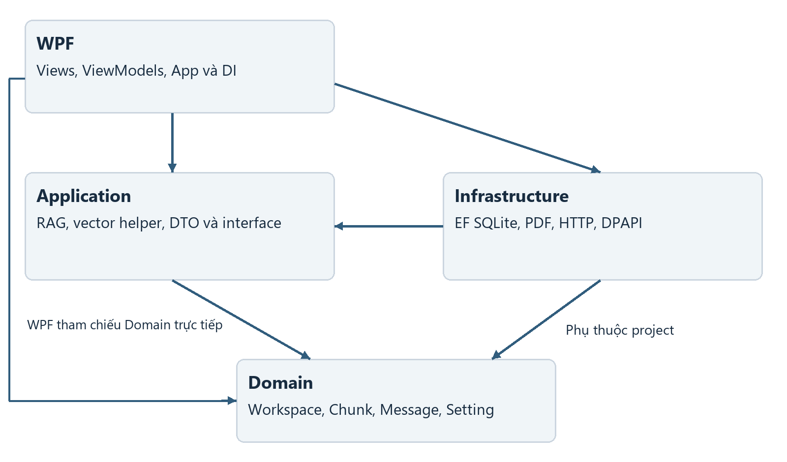
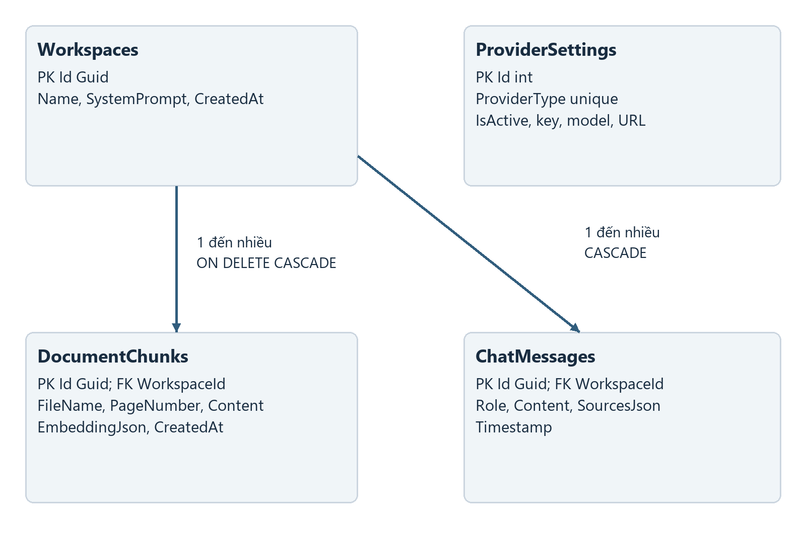
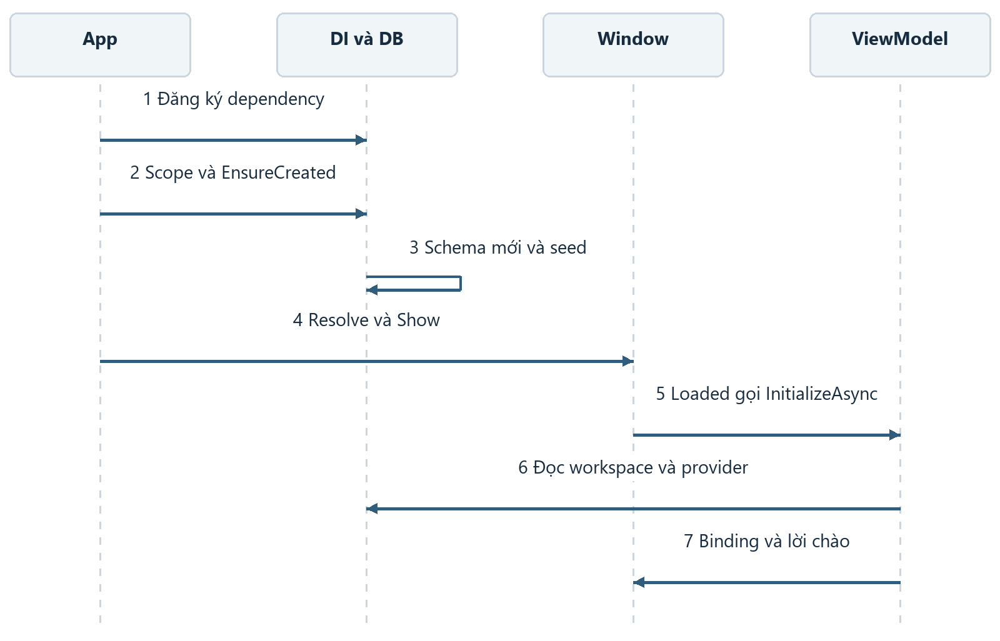
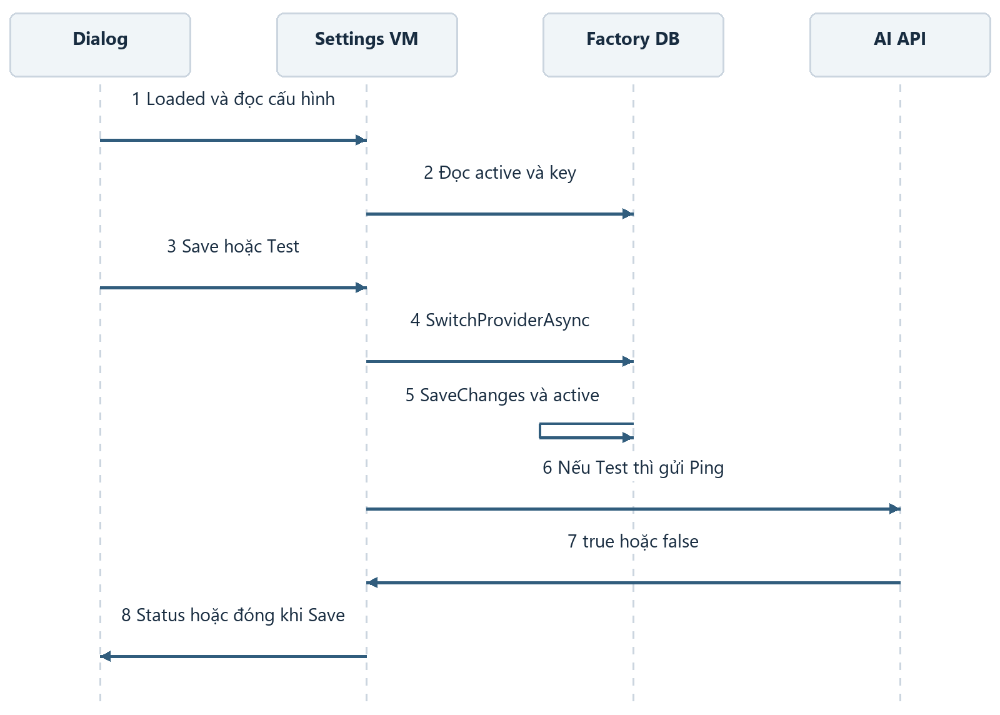
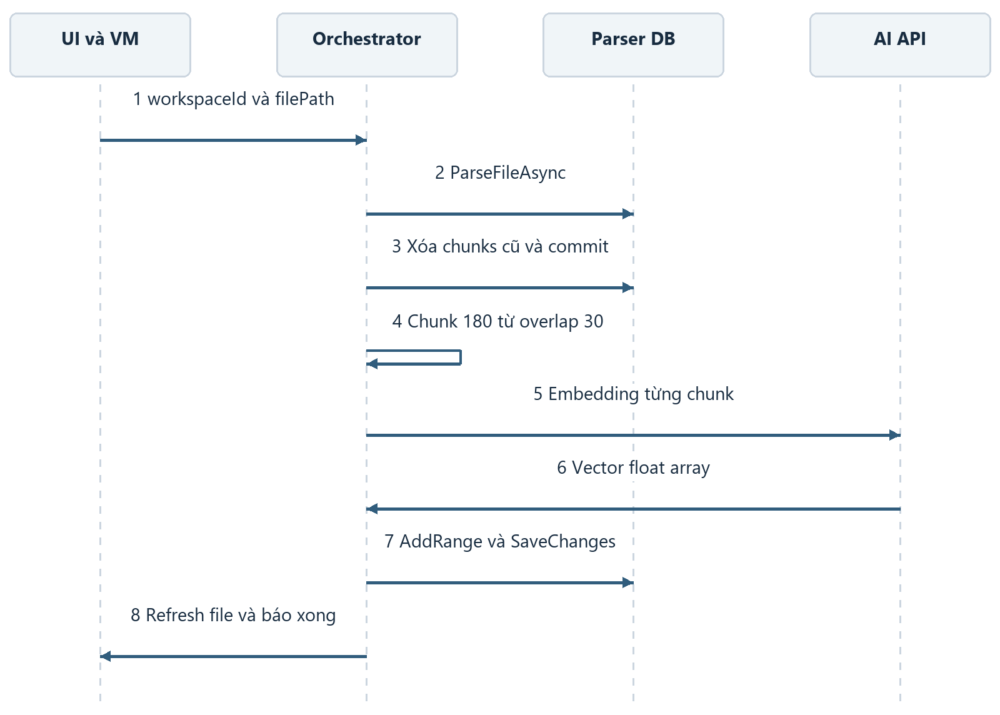
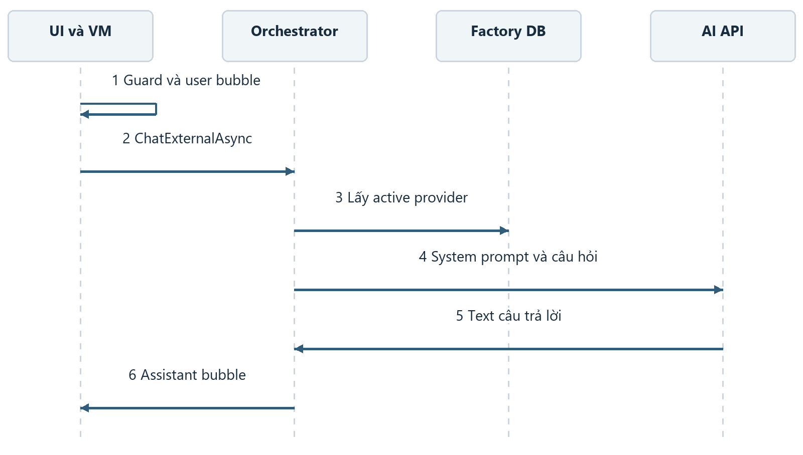
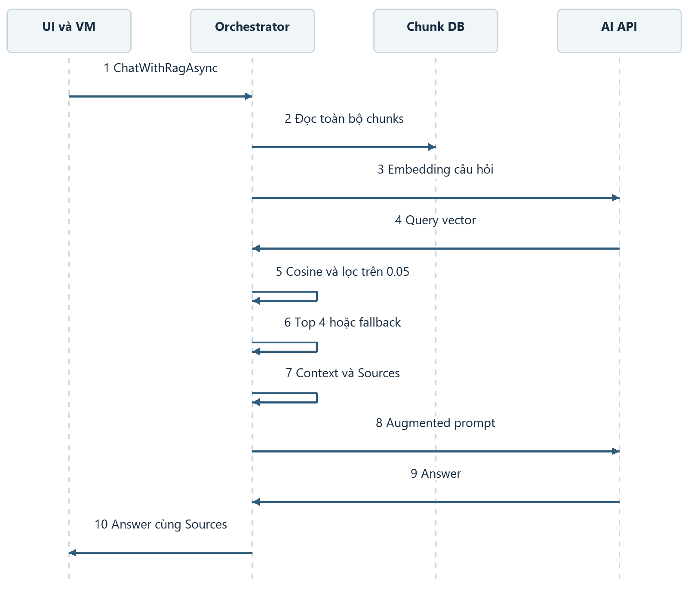
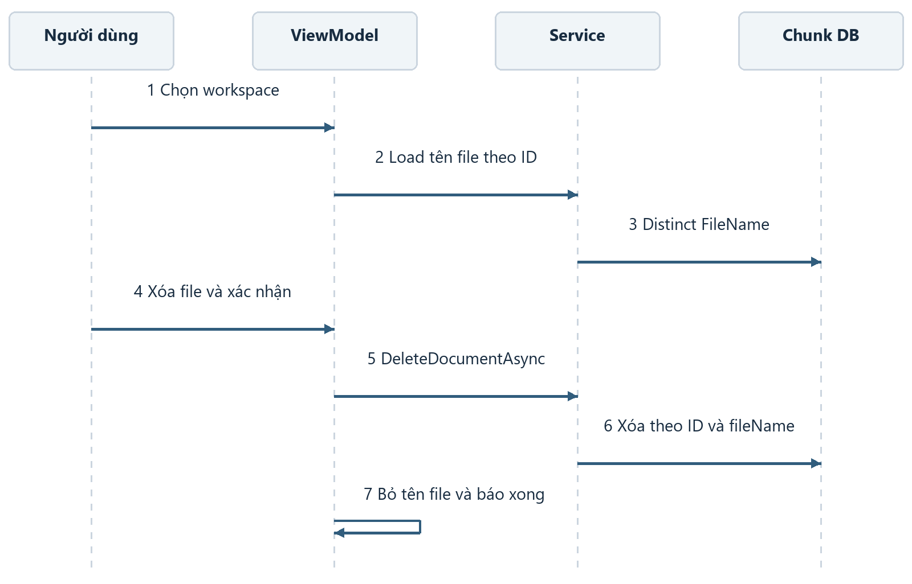
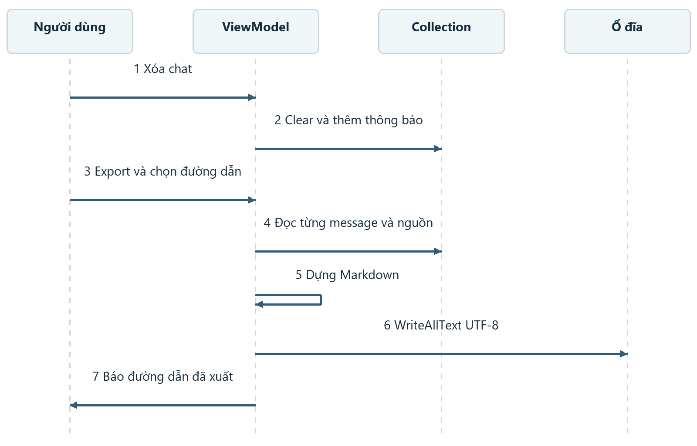

> Tài liệu lịch sử của bản gốc 355df3d. Luồng/schema và trạng thái sửa lỗi hiện hành: [05_Fixes_va_Nghiem_thu.md](05_Fixes_va_Nghiem_thu.md). Các mô tả lỗi dưới đây là bằng chứng trước khi sửa.

# Luồng hoạt động của project DocuMind

Tài liệu giải thích cách giao diện WPF, application service, database và API phối hợp trong ứng dụng trợ lý học tập DocuMind. Mỗi luồng cho biết điểm vào, dữ liệu đi qua hệ thống, kết quả và tình huống thất bại để thành viên nhóm có thể theo dõi một thao tác từ UI đến nơi xử lý.

Baseline `355df3d`, đối chiếu ngày 05 tháng 11 năm 2026. Các sơ đồ mô tả implementation hiện tại. SQL Server là lựa chọn chuyển đổi được hướng dẫn trong tài liệu setup; runtime gốc dùng SQLite. File Markdown này là nguồn để tái xuất bản Word.

## 1 Kiến trúc và ranh giới xử lý

View hiển thị dữ liệu và phát command qua binding. MainViewModel giữ trạng thái màn hình, chọn chế độ chat và gọi RagOrchestratorService. Service điều phối parser, repository và AI qua các interface của Application. Infrastructure triển khai việc đọc PDF, lưu SQLite, bảo vệ key và gọi HTTP.

Domain chỉ mô tả dữ liệu và enum. App.xaml.cs là nơi ghép dependency cụ thể. Mũi tên phụ thuộc project đi từ WPF tới Application/Infrastructure/Domain, từ Infrastructure tới Application/Domain và từ Application tới Domain. Tests tham chiếu ba lớp nghiệp vụ, chưa tham chiếu WPF.

**Dữ liệu ra ngoài:** ingest gửi từng chunk đến embedding API. RAG gửi câu hỏi tới embedding API, sau đó gửi top chunks cùng câu hỏi đến chat API. Direct Chat gửi system prompt và câu hỏi. File gốc không được upload nguyên khối bởi pipeline này, nhưng text được trích xuất có thể rời máy.

**Điểm kiểm tra:** khi gặp lỗi, xác định nó ở UI command, parser, DB hay HTTP. Thông báo generic từ TestConnection có thể che lỗi HTTP; stack của code gốc và trạng thái DB cần được đối chiếu thay vì suy ra từ nhãn màu xanh trên giao diện.

## 2 Mô hình dữ liệu và vòng đời

Workspace có quan hệ một nhiều tới DocumentChunks và ChatMessages qua WorkspaceId. Hai khóa ngoại đều cascade khi xóa workspace. ProviderSettings độc lập; unique index ProviderType ngăn cấu hình trùng cùng provider nhưng không ngăn hai dòng IsActive=true nếu chỉnh trực tiếp bằng SQL.

| Dữ liệu | Vị trí hiện tại | Sau khi đóng app |
| --- | --- | --- |
| Workspace và system prompt gốc | SQLite | Còn |
| Text chunks và embedding JSON | SQLite | Còn |
| Provider và ciphertext key | SQLite | Còn, phụ thuộc DPAPI của người dùng |
| Tin nhắn hiển thị | ObservableCollection trên MainViewModel | Mất nếu chưa export |
| Hội thoại gửi cho AI | Một request chứa system và user | Request sau không mang lịch sử cũ |
| File Markdown export | Đường dẫn người dùng chọn | Còn trên ổ đĩa |
| File tài liệu gốc | Đường dẫn ngoài app | App không quản lý bản sao |

ChatMessages có schema và navigation property nhưng chưa được MainViewModel/RagOrchestrator lưu hoặc load. Không dùng việc tồn tại bảng để suy ra có persistence cho chat. Guid và thời gian được C# tạo; insert bằng SQL cần cung cấp đủ giá trị.

## 3 Luồng khởi động

**Điều kiện bắt đầu:** người dùng chạy binary WPF, môi trường Windows có runtime phù hợp và thư mục binary ghi được database. Điểm vào là constructor App rồi OnStartup.

1. App đăng ký AppDbContext UseSqlite, HttpClient, repositories, parser, factory, orchestrator, ViewModels và Views.
2. OnStartup tạo scope ngắn, resolve AppDbContext và gọi EnsureCreated.
3. Database mới được tạo với bốn bảng và workspace mặc định. DB đã có bảng không được tự migrate.
4. Scope khởi tạo đóng; MainWindow được resolve từ root provider và Show.
5. Loaded gọi InitializeAsync. ViewModel đọc Workspaces, chọn phần tử đầu tiên.
6. OnSelectedWorkspaceChanged bắt đầu đọc danh sách file; InitializeAsync tiếp tục đọc provider và thêm lời chào.

**Kết quả:** màn hình có workspace, danh sách file và mô tả provider; IsBusy tắt sau finally. Nếu chưa có config, hiển thị yêu cầu mở Cài đặt.

**Nhánh lỗi:** lỗi database/startup được MessageBox hiển thị rồi Shutdown(1). Lỗi InitializeAsync được MessageBox báo; callback tải file có catch rỗng. Callback async void và các service được giữ ở root có thể tạo query chồng lấn; đây là rủi ro cần tái hiện, chưa được baseline test xác nhận.

## 4 Luồng cấu hình và kiểm tra provider

**Điểm vào:** OpenSettingsCommand gọi action do MainWindow cung cấp. Dialog có SettingsViewModel riêng, nhưng dùng factory/context được resolve từ container hiện tại.

1. Dialog.Loaded gọi InitializeAsync, đọc provider active và giải mã key.
2. Chọn provider đặt lại model/Base URL mặc định, đồng thời bắt đầu đọc key đã lưu.
3. SaveAsync kiểm tra key không rỗng, trừ OllamaLocal, rồi gọi SwitchProviderAsync.
4. Factory tắt active của mọi config, tìm/tạo config đích, mã hóa key nếu có, lưu model/Base URL/temperature và active=true.
5. SaveChanges commit. Save thành công đóng dialog; MainWindow refresh tên provider.

**Luồng kiểm tra khác Save:** TestConnectionAsync cũng thực hiện bước 3–5 trước, sau đó lấy active service và gọi Ping. Nó không tạo một provider tạm thời và không rollback khi Ping thất bại. Ping chỉ test chat, chưa gọi embedding.

**Nhánh lỗi:** form từ chối key rỗng với provider cloud. API lỗi/response rỗng làm test false nhưng cấu hình vừa lưu vẫn active. Key cũ có thể còn trong form khi chuyển sang provider chưa lưu key. Load key fire-and-forget có thể trả về sai thời điểm nếu đổi lựa chọn nhanh. Base URL tùy chỉnh không được Gemini service sử dụng.

**Tác động:** thao tác Test không phải read-only trong bản hiện tại. Trước demo, kiểm tra lại provider active và key sau khi thử một cấu hình lỗi. Xem BUG-006 và BUG-007 để sửa hành vi.

## 5 Luồng nạp tài liệu

**Đầu vào:** workspaceId, đường dẫn file, progress và CancellationToken. UI mở file picker chọn nhiều file, xử lý lần lượt. Không có Document entity hoặc bản sao file gốc được tạo.

1. UploadDocumentAsync đặt IsBusy và gọi IngestDocumentAsync cho từng file.
2. Service kiểm tra File.Exists, gọi parser; danh sách trang rỗng gây lỗi ngay.
3. PDF dùng PdfPig lấy text từng trang; file khác dùng ReadAllText và PageNumber=1.
4. Service lấy active provider và xóa chunks cũ có cùng workspaceId/FileName. Repository commit xóa ngay.
5. Mỗi trang được chia 180 từ/chunk, overlap 30 từ.
6. Mỗi chunk gọi embedding tuần tự. Vector được serialize thành JSON, entity nằm trong list tạm.
7. Chỉ khi toàn bộ embeddings thành công, AddRange rồi SaveChanges lưu list.
8. UI tải lại tên file và thêm thông báo thành công trong chat phiên.

**Nhánh lỗi quan trọng:** fail trước bước 4 giữ nguyên chunks cũ. Fail sau bước 4 có thể mất dữ liệu cũ; transaction của một lần SaveChanges không bao phủ cả chuỗi HTTP và lần xóa trước đó. Với nhiều file, file trước đã thành công vẫn tồn tại khi file sau thất bại.

**Giới hạn:** PDF scan cần OCR; tài liệu lớn có nhiều request embedding. Hai file khác đường dẫn nhưng trùng tên sẽ ghi đè tập chunks trong cùng workspace. Hủy token giữa các trang PDF có thể chỉ break vòng lặp; UI chưa có Cancel nên người dùng chưa điều khiển được token này.

## 6 Luồng Direct Chat

**Điều kiện:** có input, không IsBusy và có SelectedWorkspace. Dù chat không retrieval, guard hiện vẫn yêu cầu workspace được chọn.

1. SendMessageAsync trim input, xóa ô nhập và thêm user bubble.
2. IsBusy=true; UseRagMode=false chọn ChatExternalAsync.
3. Orchestrator lấy service của provider đang active từ cấu hình DB.
4. Service gửi system prompt và câu hỏi đến chat endpoint.
5. Parse JSON response thành string; ViewModel thêm assistant bubble.
6. Finally tắt IsBusy và xóa BusyStatus.

**Output:** string hiển thị bằng TextBlock. UI chưa render Markdown và không stream token. Không có dữ liệu ChatMessage nào được INSERT vào DB trong luồng này.

**Nhánh lỗi:** không có config active gây InvalidOperationException. HTTP không thành công hoặc JSON thiếu field có thể gây exception; ViewModel chuyển exception thành assistant bubble có gợi ý kiểm tra cấu hình. Câu hỏi đã bị xóa khỏi ô input, nhưng vẫn còn user bubble.

**Ngữ cảnh:** OpenAI-compatible payload có một system và một user message; Gemini có system_instruction và một user contents. Lượt kế tiếp không gửi các bubble trước, nên câu hỏi tham chiếu “ý thứ hai vừa rồi” không có đủ thông tin.

## 7 Luồng Chat RAG

**Điểm vào:** SendMessageAsync với UseRagMode=true gọi ChatWithRagAsync. Đầu vào gồm workspaceId, systemPrompt và userQuestion; mặc định topK=4, temperature=0.7.

1. Repository tải toàn bộ chunks của workspace.
2. Nếu không có chunk, service trả hướng dẫn nạp tài liệu và Sources rỗng; không gọi API.
3. Provider đang active tạo embedding câu hỏi.
4. Mỗi EmbeddingJson được deserialize; lỗi JSON bị bỏ qua và similarity thành 0.
5. Tính cosine, lọc điểm >0.05, sắp giảm dần và lấy tối đa topK.
6. Nếu không có điểm qua ngưỡng, fallback lấy topK từ toàn bộ chunks, kể cả vector không tương thích cho điểm 0.
7. Dựng context gồm file, trang, điểm và text; tạo RagSourceDto cho từng chunk.
8. Dựng augmented prompt yêu cầu dùng nguồn và không suy đoán ngoài tài liệu.
9. Gọi chat model, trả ChatResultDto chứa answer và sources.
10. UI thêm assistant bubble và khung nguồn; finally tắt IsBusy.

**Ý nghĩa điểm:** cosine similarity là phép so sánh vector, không phải phần trăm độ tin cậy của câu trả lời. Nguồn là kết quả retrieval trước lúc model sinh answer, chưa được đối chiếu ngược với từng luận điểm.

**Rủi ro:** đổi provider/model có thể tạo vector khác dimension hoặc khác không gian dù cùng dimension. Code chưa lưu metadata để phát hiện. Fallback có thể che lỗi này bằng nguồn không liên quan. Nếu endpoint embedding không dùng được, cả ingest và hỏi RAG thất bại dù Direct Chat vẫn hoạt động.

## 8 Luồng workspace và xóa tài liệu

**Đổi workspace:** SelectedWorkspaceChanged nạp SystemPrompt từ entity, gọi GetWorkspaceFilesAsync và thay UploadedFiles. ChatMessages không được clear hoặc load lại theo workspace. Vì vậy bubble của workspace trước có thể vẫn hiện khi đang xem tài liệu workspace khác.

**Xóa tài liệu:** DeleteDocumentCommand nhận fileName từ item, kiểm tra SelectedWorkspace rồi hỏi xác nhận. Nếu Yes, service gọi DeleteByFileNameAsync. Repository tìm tất cả chunks có cùng workspaceId/fileName, RemoveRange và SaveChanges; UI xóa tên file và thêm thông báo phiên.

**Ảnh hưởng:** xóa tập vector/text trong database, không xóa file gốc. Các câu trả lời và Sources đang có trên UI giữ nguyên; chúng là snapshot trước thời điểm xóa. Không có hoàn tác trong app. Thao tác hủy MessageBox không gọi repository.

**Nhánh lỗi:** delete command chưa có try/catch riêng nên lỗi DB cần được xử lý thêm. Đổi workspace nhanh hoặc trong khi upload có thể làm dữ liệu hiển thị không khớp kết quả async; cần khóa lựa chọn hoặc kiểm tra workspaceId trước khi cập nhật UI.

## 9 Luồng xóa chat và export

**Xóa chat:** ClearChatCommand xóa collection và thêm một assistant bubble “Đã xóa lịch sử trò chuyện phiên này”. Không gọi repository, không xóa file export và không ảnh hưởng chunks.

**Export:** ExportMarkdownCommand kiểm tra ChatMessages.Count, mở SaveFileDialog cho MD/TXT rồi dựng StringBuilder. Header ghi workspace đang chọn, thời gian và trạng thái toggle RAG tại lúc xuất. Mỗi message có thời gian hiển thị, sender, content và tên file/trang/điểm nếu có nguồn.

File được ghi đồng bộ bằng UTF-8 tới đường dẫn người dùng chọn. Không ghi Sources.Content đầy đủ riêng trong danh sách nguồn; nội dung chính answer vẫn được export. File không phải bản sao database và không có cơ chế import lịch sử trở lại app.

**Nhánh lỗi:** người dùng Cancel thì không ghi. Lỗi quyền ghi, ổ đầy hoặc file khóa chưa có catch riêng. Trong phiên chat đã đổi mode/workspace, header export có thể không phản ánh chính xác từng message. Tính năng lưu mode/workspace theo message là một cải tiến cần thiết.

## 10 Các điểm kiểm tra và đề xuất sửa

| Bước quan sát | Kiểm tra được | Chưa kết luận được |
| --- | --- | --- |
| Build và 14 test pass | Baseline compile, helper/repository/seed/DPAPI test | Chất lượng retrieval và API live |
| Ping chat pass | Chat endpoint trả text với cấu hình đó | Embedding endpoint, quyền model khác |
| Ingest có chunks | Parser và embedding đã chạy cho file đó | Nguồn đủ bao phủ mọi câu hỏi |
| Sources có score cao | Vector query gần vector chunk | Luận điểm answer chắc chắn đúng |
| Bảng ChatMessages tồn tại | Schema có chỗ lưu message | UI đã persist lịch sử |
| Chạy SQL Server script | Schema SQL Server có thể truy vấn | App đã chuyển từ SQLite |

Ưu tiên sửa ingest nguyên tử, cấu hình/metadata embedding và key trước khi phát triển thêm quiz hoặc lịch sử. Sau đó sửa side effect của Test, lifetime DbContext, lưu history và migration schema. Chi tiết tái hiện và nghiệm thu nằm trong `04_Bug_va_Cai_tien.md`.

## 11 Nguồn và cách tái xuất bản

Source chính: App.xaml.cs, MainWindow.xaml và code-behind, hai ViewModel, RagOrchestratorService, VectorMathHelper, AppDbContext, EfRepository, parser và AI services thuộc baseline 355df3d. Tên class/method trong tài liệu giữ nguyên để tìm bằng rg hoặc Find in Files.

Đối chiếu hành vi thư viện với [Microsoft EnsureCreated](https://learn.microsoft.com/en-us/ef/core/managing-schemas/ensure-created) và [Microsoft EF Core SQL Server](https://learn.microsoft.com/en-us/ef/core/providers/sql-server/), tra cứu ngày 05 tháng 11 năm 2026. Chi tiết model/provider và các nguồn khác nằm trong tài liệu hướng dẫn code.

Chạy `docs/tools/build_docs.py` bằng Python có python-docx và Pillow để dựng lại sơ đồ và hai DOCX. Nội dung lấy từ hai file Markdown, không chỉnh sửa riêng DOCX sau khi xuất. Sau khi sửa source, render lại và kiểm tra toàn bộ trang trước khi gửi bản mới cho nhóm.
